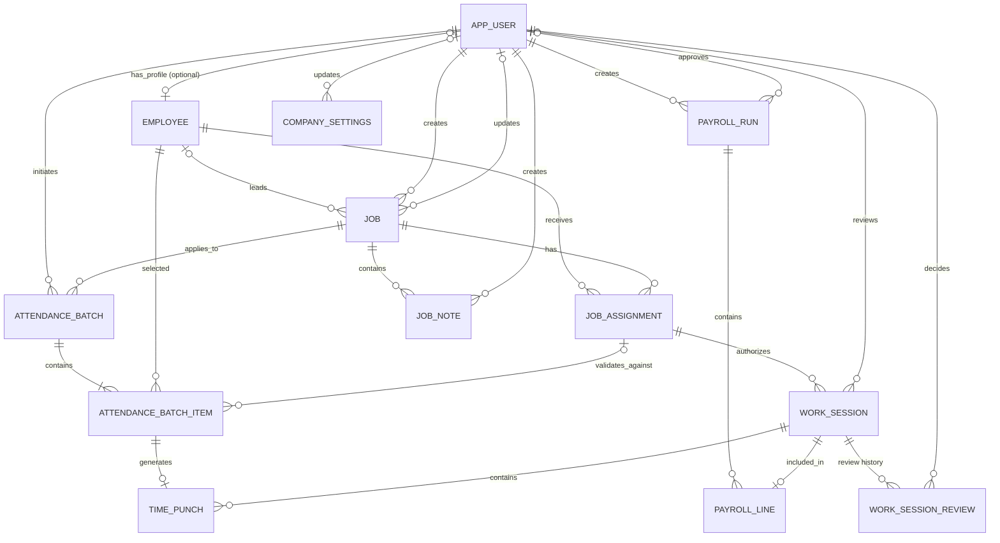

# Data model

This document describes the implemented schema. It follows the ERD provided
on 2026-11-06, with the additions and assumptions listed below. Each table
maps to a Django model in the owning app.

`CLIENT` is intentionally standalone, with no relationships (ADR 010).

## Table → model mapping

| ERD table | Model | App |
| --- | --- | --- |
| APP_USER | `User` | accounts |
| EMPLOYEE | `Employee` | workforce |
| CLIENT | `Client` | clients |
| JOB | `Job` | jobs |
| JOB_ASSIGNMENT | `JobAssignment` | jobs |
| ATTENDANCE_BATCH | `AttendanceBatch` | timekeeping |
| ATTENDANCE_BATCH_ITEM | `AttendanceBatchItem` | timekeeping |
| WORK_SESSION | `WorkSession` | timekeeping |
| TIME_PUNCH | `TimePunch` | timekeeping |
| *(added 2026-11-06, Phase 1)* WORK_SESSION_REVIEW | `WorkSessionReview` | timekeeping |
| PAYROLL_RUN | `PayrollRun` | payroll |
| PAYROLL_LINE | `PayrollLine` | payroll |
| JOB_NOTE | `JobNote` | team_notes |
| *(added)* COMPANY_SETTINGS | `CompanySettings` | company |

Column names follow Django conventions. For example, `JobID` becomes `id`,
`LeadHandEmployeeID` becomes `lead_hand`, and `PerformedByUserID` becomes
`performed_by`.

## Additions to the ERD

Each addition is backed by an earlier accepted decision.

| Where | Added | Why |
| --- | --- | --- |
| `COMPANY_SETTINGS` (new, single row) | `workers_can_create_notes` (default `false`), `updated_at`, `updated_by` | An Admin-controlled company setting (ADR 009) |
| `APP_USER` | `role` (`admin`, `manager`, `leadhand`, `worker` = Employee), `first_name`, `last_name`, `is_staff`, `is_superuser`, `last_login`, `date_joined` | The application role (ADR 007, ADR 011) plus Django's auth fields. Password hashing is Django's. `manager` was added on 2026-11-10 by `accounts.0002`, which changes choices only and runs no SQL. |
| `EMPLOYEE` | `employee_number` (unique, optional), `created_at`, `updated_at` | The separate, non-secret employee identifier (ADR 007) |
| `JOB` | `created_at`, `updated_at` | Audit |
| `JOB_ASSIGNMENT` | `updated_at` | Audit |
| `ATTENDANCE_BATCH` | `distance_meters`, `location_flags` (array) | ADR 004: store the distance from the geofence centre, and every location condition, not just the primary one |
| `WORK_SESSION` | `created_at`, `updated_at` | Audit |
| `JOB_NOTE` | `updated_by`, `deleted_at`, `deleted_by` | ADR 009: soft deletion with audit information, and moderation |
| `WORK_SESSION_REVIEW` (new, approved for timekeeping Phase 1) | `session`, `decision`, `reason`, `reviewed_by`, `reviewed_at` | An append-only audit trail; every review decision requires a reason |
| `WORK_SESSION` (approved for Phase 1) | `exception_flags` (array, no duplicates) | Why the session needs review: location flags from its punches, `future_timestamp` or `clock_out_rejected` |
| `ATTENDANCE_BATCH` (approved 2026-11-10, ADR 011) | `entry_reason` (text, empty by default) | The optional reason for an administrative entry |
| `ATTENDANCE_BATCH_ITEM` (approved for Phase 1) | `result_code` | A stable, machine-readable outcome, so retries return exactly the original result |

## Deviations from the ERD notation

| ERD | Implemented | Reason |
| --- | --- | --- |
| `APP_USER \|\|--o\| EMPLOYEE`: every employee has exactly one user | `Employee.user` is nullable and unique (an optional one-to-one link) | ADR 007: employees can exist without an account |
| `EMPLOYEE \|\|--o{ JOB : leads`: every job has a LeadHand | `Job.lead_hand` is nullable | Confirmed 2026-11-06: an Admin can create a job and assign the LeadHand later |

## Constraints enforced by the database

| Table | Constraint |
| --- | --- |
| User | Email is unique, case-insensitively |
| Employee | `user` is unique; `employee_number` is unique when set; `hourly_rate` ≥ 0 |
| Job | `job_number` is unique; latitude and longitude are both set or both empty and within range; radius > 0; `end_date` ≥ `start_date` |
| JobAssignment | One **active** assignment per (employee, job); `end_date` ≥ `start_date` |
| AttendanceBatch | `idempotency_key` is unique; coordinates both set or both empty; accuracy and distance only with coordinates, and ≥ 0 |
| AttendanceBatchItem | One item per (batch, employee); an accepted item must have an assignment and a `processed_at`; an accepted item has an accepted code (`clocked_in` or `clocked_out`); a rejected item has a rejection code |
| WorkSession | One **open** session per assignment; reviewer and review time set together; an approved or rejected review needs a reviewer |
| TimePunch | `batch_item` is unique (one punch per item); one clock-in and one clock-out per session |
| PayrollRun | `period_end` ≥ `period_start`; approver and approval time set together; approved or paid status needs an approval; `paid_at` needs an approval |
| PayrollLine | `session` is unique (paid once); hours and rate ≥ 0; `final_amount = gross_pay + adjustment_amount` |
| JobNote | Content is not empty; `deleted_at` and `deleted_by` set together |
| CompanySettings | Exactly one row (`id = 1`) |
| WorkSessionReview | The reason must not be blank. Rows are append-only: model `save()` and `delete()` refuse to change existing rows, and the admin is read-only. |

Every foreign key uses `PROTECT`, so attendance and payroll history can't be
deleted from under its references. The one exception is
`PayrollLine → PayrollRun`, which cascades so that deleting a draft run
removes its lines. Services block deleting approved runs.

## How the flows map onto the tables

**Clock-in, individual or group (ADR 003, 006).**

1. The device sends one `AttendanceBatch` containing:
   - the action, the job, and the performer
   - the device time (`captured_at`) and the location
   - the `idempotency_key`
2. The server creates one `AttendanceBatchItem` per selected employee. An
   individual punch is a batch with one item.
3. Each employee is validated separately against their active
   `JobAssignment`. The item is `accepted` or `rejected`, with a message.
4. Each accepted item generates one `TimePunch` in that employee's
   `WorkSession`. A clock-in opens a session; a clock-out closes it.
5. Location is assessed once per batch by `assess_punch_location`. Its result
   (status, flags, sanitised coordinates and distance) is stored on the
   batch.
6. If the result requires review, the affected sessions get
   `review_status = pending`.

**Times and dates.**

- A punch's instant is its batch's `captured_at`, the device time.
- The server's `received_at` is kept alongside it, for audit and to detect
  clock skew.
- `WorkSession.work_date` is the clock-in instant converted to the company
  timezone (ADR 008).

**Payroll (hourly MVP).**

- A `PayrollLine` per closed (and, where required, approved) session
  snapshots `hours_paid` and `hourly_rate_applied`, where the rate is
  `Employee.hourly_rate` at calculation time.
- `gross_pay = round_money(hours × rate)` and
  `final_amount = gross_pay + adjustment_amount`.
- Approved runs keep their snapshot even if the employee's rate changes
  later.

## Assumptions (no schema impact, easy to change)

| Item | Assumption |
| --- | --- |
| `Job.status` values | planned, active (default), on_hold, completed, cancelled. Punching is intended for active jobs. |
| `JobAssignment.status` values | active, ended, cancelled |
| `AttendanceBatch.source` values | `mobile_online`, `mobile_offline_sync`, `admin_entry`. `admin_entry` marks an Admin or Manager recording attendance for someone else (ADR 011). |
| `AttendanceBatchItem.result_status` values | pending, accepted, rejected |
| `WorkSession` status values | `session_status` is open or closed. `review_status` is not_required, pending, approved or rejected. |
| `PayrollRun.status` values | draft, approved, paid, cancelled |
| Precision | Coordinates (9,6); accuracy and distance (10,2); `hourly_rate` and `hourly_rate_applied` (10,4); `hours_paid` (9,4); money (12,2); `GeofenceRadius` is a positive integer in metres, as in the ERD |
| The LeadHand on their own job | To clock themselves in, the LeadHand needs an active `JobAssignment` on that job. **None is created automatically.** |
| "Jobs they manage" (group clock, crew, notes) | **Confirmed 2026-11-10:** `Job.lead_hand` is the LeadHand's employee record **and** the LeadHand holds an active assignment on the job (`apps/jobs/selectors/scope.py`) |

## Deferred, by decision

- **Compensation types and effective-dated rate history.** The MVP is hourly
  only with `Employee.hourly_rate`, as in the ERD. Adding daily or fixed/task
  pay will need new columns or tables (ADR 005).
- **Client relationships and client access.** ADR 010.
- **Punch corrections.** The model is append-only. A correction design
  (for example a correcting batch that references the original) will be
  added when the correction rules are decided. Payroll-level corrections use
  `adjustment_amount`.
